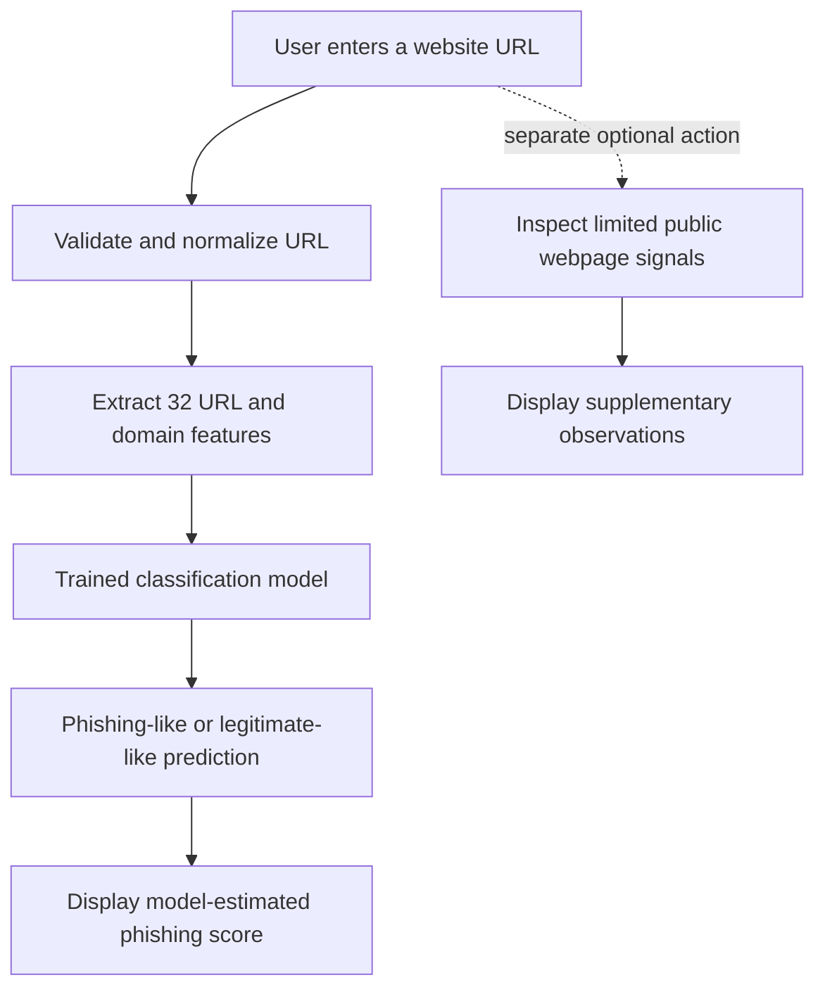

# Phishing Website Detection

**Classify a URL as phishing-like or legitimate-like using Python, scikit-learn and Streamlit.**


Paste a website URL, and the app extracts 32 lexical/domain features from the URL string, runs a trained classifier and shows a prediction with a model-estimated phishing score. Four classical algorithms are compared on the [UCI PhiUSIIL Phishing URL dataset](https://archive.ics.uci.edu/dataset/967/phiusil%2Bphishing%2Burl%2Bdataset) using a hostname-disjoint evaluation split.

> **Educational prototype, not a security product.** A prediction is not proof that a site is safe or malicious. Use trusted security tools and official channels to verify suspicious sites.

<!-- Add after running the app:  -->

## Contents

[Features](#features) · [How it works](#how-it-works) · [Quick start](#quick-start) · [Dataset](#dataset) · [Evaluation](#evaluation) · [Results](#results) · [Project structure](#project-structure) · [Webpage inspection and safety](#optional-webpage-inspection-and-safety) · [Limitations](#limitations) · [Contributing](#contributing) · [License](#license)

## Features

- **URL in, verdict out** - no manual feature entry; the app computes the features itself.
- **One extractor for training and inference** (`src/url_features.py`) so both paths always see identical features.
- **Four-model comparison** - Logistic Regression, Decision Tree, Linear SVM, Gaussian Naive Bayes.
- **Leakage-aware evaluation** - hostname-grouped train/test split and grouped cross-validation.
- **Metrics and interpretation** - accuracy, phishing precision/recall/F1, ROC-AUC, confusion matrix, error analysis, permutation importance.
- **Optional, separate page inspection** - user-triggered, SSRF-guarded HTML signals that never affect the prediction.
- **Reproducible** - tests, CI, a notebook, a feature dictionary and a DOCX report generator.

## How it works



The classifier uses only features derived from the URL text; it never opens the site. Feature definitions: [`docs/URL_Feature_Dictionary.md`](docs/URL_Feature_Dictionary.md).

## Quick start

Requires Python 3.11+ and an internet connection for the first dataset download.

```bash
git clone https://github.com/<your-username>/phishing-website-detection-ml.git
cd phishing-website-detection-ml
```

**Create an environment and install**

```bash
# macOS / Linux
python3 -m venv .venv && source .venv/bin/activate
```

```powershell
# Windows (PowerShell)
py -m venv .venv
Set-ExecutionPolicy -Scope Process -ExecutionPolicy Bypass -Force
.\.venv\Scripts\Activate.ps1
```

```bash
python -m pip install --upgrade pip
python -m pip install -r requirements-dev.txt   # use requirements.txt if you do not need the tests
```

**Run**

```bash
python -m pytest                 # offline tests
python src/train_model.py        # download data, compare models, save artifacts/ and reports/figures/
streamlit run app.py             # open http://localhost:8501
python generate_report.py        # optional: DOCX report from your local results
```

Windows users can also double-click `run_all_windows.bat` to do all of the above in order.

## Dataset

The project uses the raw **URL** column and the **label** from UCI PhiUSIIL Phishing URL (Website), ID 967 (235,795 records: 134,850 legitimate, 100,945 phishing), and computes its own features from the URL string.

- UCI labels (`1` = legitimate, `0` = phishing) are converted to the project convention: **`1` = phishing, `0` = legitimate**.
- Cleaning removes empty values, normalized duplicates and URLs that appear with conflicting labels; URLs that cannot be parsed are skipped.
- The first training run downloads the data and caches a minimal `data/phiusiil_url_labels.csv`, which is excluded from Git.
- License: CC BY 4.0. Citation: Prasad, A. & Chandra, S. (2024). *PhiUSIIL Phishing URL (Website).* UCI Machine Learning Repository. https://doi.org/10.1016/j.cose.2023.103545

## Evaluation

- **Split:** about 80/20, stratified and grouped by hostname, so no hostname appears in both train and test.
- **Model selection:** highest mean F1 from 5-fold stratified group cross-validation on the training hosts.
- **Reported on the test split:** accuracy, precision/recall/F1 for the phishing class, ROC-AUC, confusion matrix, error analysis, permutation importance.
- The selected model is saved to `artifacts/best_url_model.joblib` (Linear SVM is probability-calibrated for display).

## Results

Metrics depend on your dataset download and split, so none are hard-coded here. After training, generate the table from your own run:

```bash
python scripts/results_to_markdown.py
```

Paste the output below and add `reports/figures/confusion_matrix.png` to `docs/images/` if you want to show it.

<!-- RESULTS_TABLE_START -->
_Run the training script and paste the generated table here._
<!-- RESULTS_TABLE_END -->

## Project structure

```text
.
├── app.py                      # Streamlit interface
├── generate_report.py          # DOCX report from local results
├── requirements.txt            # Runtime dependencies
├── requirements-dev.txt        # + pytest
├── src/
│   ├── url_features.py         # Shared 32-feature extractor
│   ├── data_loader.py          # UCI download, cleaning, label mapping
│   ├── train_model.py          # Training and evaluation
│   └── page_inspector.py       # Optional guarded page inspection
├── tests/                      # Offline pytest suite
├── scripts/results_to_markdown.py
├── notebooks/Phishing_URL_Detection.ipynb
├── docs/                       # Feature dictionary, viva Q&A, images/
├── data/  artifacts/  reports/ # Generated locally, ignored by Git
└── .github/                    # CI workflow, issue and PR templates
```

## Optional webpage inspection and safety

A separate **Inspect public webpage signals** button makes one limited request to the entered public site and shows observations such as title, forms and external links. It only allows public IPs on ports 80/443, rejects embedded credentials, re-validates every redirect (max 4), caps response size and time, and does not run JavaScript, submit forms or keep cookies. Its output never changes the ML prediction. The target site can see your IP address, so do not inspect private or sensitive URLs. See [`SECURITY.md`](SECURITY.md) for known limits.

## Limitations

- URL-only features cannot see page content, scripts or compromised legitimate sites.
- Benchmark performance may not transfer to current real-world traffic; phishing tactics change quickly.
- A low score does not prove a site is safe, and a high score does not prove malicious intent.
- Built for learning and demonstration, not as a browser warning or antivirus replacement.

## Contributing

See [`CONTRIBUTING.md`](CONTRIBUTING.md). Run `python -m pytest` before opening a pull request.

## License

Source code: [MIT](LICENSE). The UCI dataset is a separate resource under CC BY 4.0; third-party packages keep their own licenses. Built as a B.Tech Artificial Intelligence & Data Science course project.
